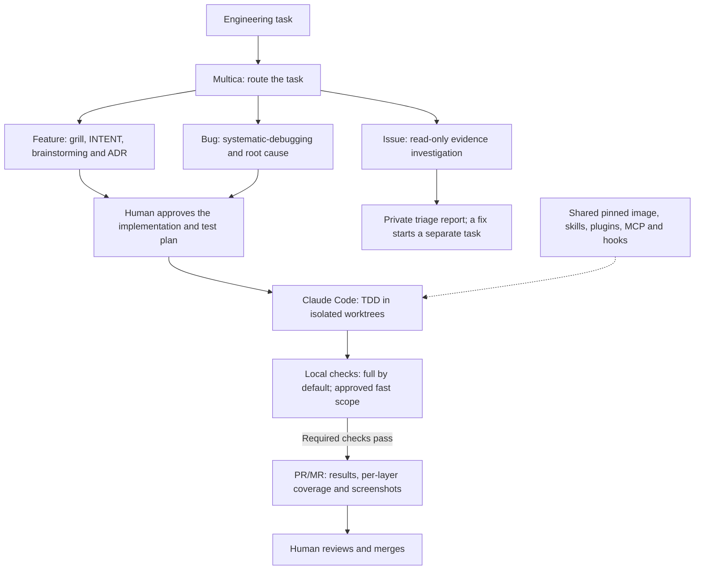

# Opinionated Multica

A repeatable setup for Claude Code agents that work through Multica.

**Status:** strategy and setup preparation, 22 November 2026. No Multica service or runner has been deployed by this repository.
The runner image, private skill/plugin bundle and product verification adapters still need implementation and acceptance.

## What this project is about

Opinionated Multica defines how AI agents help TipTip engineers develop features, investigate bugs and triage issues.
Multica assigns the work. Claude Code runs it inside pinned containers on dedicated worker VMs.

Every runner receives the same approved skills, plugins, MCP definitions, toolchain catalog and hooks.
Each repository keeps its own locked dependencies, tests and project guidance.
Parallel agents use separate worktrees and test services, so they do not edit one shared workspace.

The strategy is documented and tracked. The runner image, private extensions and product workflows still need implementation and certification.
Start with the [six implementation issues](docs/implementation.md#tracking-issues). Ronda is the first pilot.

## Workflow sequence

This graph shows the planned workflow. It does not claim that runners are deployed.



| Workflow | First steps | Result |
| --- | --- | --- |
| Feature development | Use grill-with-docs. Create a task-specific INTENT.md. Use Superpowers brainstorming. Record the design and architecture decision record (ADR). | A human approves the implementation and test plan before agents write code. |
| Bug triage | Use Superpowers systematic-debugging. Reproduce the bug and confirm its cause. | A human approves the fix plan. The agent adds a failed regression test before the fix. |
| Issue triage | Use the TipTip issue-triage skill. Start with Loki, then use its conditional Sentry, browser and deployed-source checks. | A private evidence report. A code fix starts a separate approved task. |

For any code task, the agent follows this sequence:

1. Obtain human approval for the implementation and test plan.
2. Write a test that fails for the missing behavior. Implement the change, then refactor while tests pass.
3. Run the local checks on the candidate commit. Use full regression unless the approved change scope permits fast mode.
4. Report unit line/branch coverage and integration/UI scenario coverage separately. Name every omitted or unavailable check.
5. Publish a PR/MR with actual results, the tested commit, coverage, mode and screenshots for visual changes.
6. Ask a human to review the result and perform the merge. Agent instructions reserve merging for humans.

A failed required check blocks PR publication. The agent fixes the cause and repeats the relevant checks.
New commits need fresh evidence. A material plan change returns to human plan review.
Fast mode normally excludes functional UI regression; the PR must state that limit.

### Visual overview

The stack-diagram view follows the same nodes and edges as the Mermaid source above.
Blue arrows show task progress. The dashed arrow supplies the shared runner release.

<picture>
  <source media="(prefers-color-scheme: dark)" srcset="docs/diagrams/workflow-dark.png">
  
</picture>

Sources: [Mermaid](docs/diagrams/workflow.mmd), [diagram layout](docs/diagrams/workflow.source.html), [offline HTML](docs/diagrams/workflow.html).
Read the [strategy](docs/strategy.md) for the full workflow rules and human review checklist.

## Start here

- [Intent and decisions](INTENT.md)
- [Strategy](docs/strategy.md)
- [Tests, coverage and full/fast modes](docs/testing.md)
- [Runner setup](docs/runner-setup.md)
- [Implementation work](docs/implementation.md)
- [Preparation validation](docs/validation.md)
- [PR description template](templates/pull-request-description.md)
- [Runner instructions](runner/multica-claude.local.md)

Run tests locally. A hosted workflow, GitHub Pro, ruleset or branch-protection API is **not required**.
Agents may commit, push task branches and open PRs/MRs. Instructions reserve merge and default-branch writes for humans.
This is an instruction-based trust model, not a claim of Git-server enforcement.

## Verify the preparation helpers

Install Python 3.12+ and uv. Then run:

```bash
uv sync --locked
uv run --locked python scripts/check.py full
```

For a reviewed small/non-code change:

```bash
uv run --locked python scripts/check.py fast
```

Reports are written to `reports/<mode>/`: test logs, coverage JSON/XML and a summary with mode, results and omitted layers.
This repository has no UI. Its report labels functional UI coverage **not applicable**, never passed.
Product repositories with a UI must report their actual functional scenario coverage.

## Preparation tools

- `scripts/prepare-runner.py`: validate an approved immutable image release and generate a local Compose bundle.
- `scripts/doctor-runner.py`: compare installed tool versions with that release, inside the image.
- The generated `start-runner.sh` previews by default. `--apply` logs in through stdin and starts the runner on the chosen VM.

The helpers do not build or certify the future polyglot image. See the [image contract](docs/runner-setup.md#image-contract).
The release example intentionally contains unresolved pins. Preparation rejects it until an operator provides approved values.

This repository is public. Supply private plugins, MCP credentials and account tokens separately. Do not copy a laptop HOME here.
