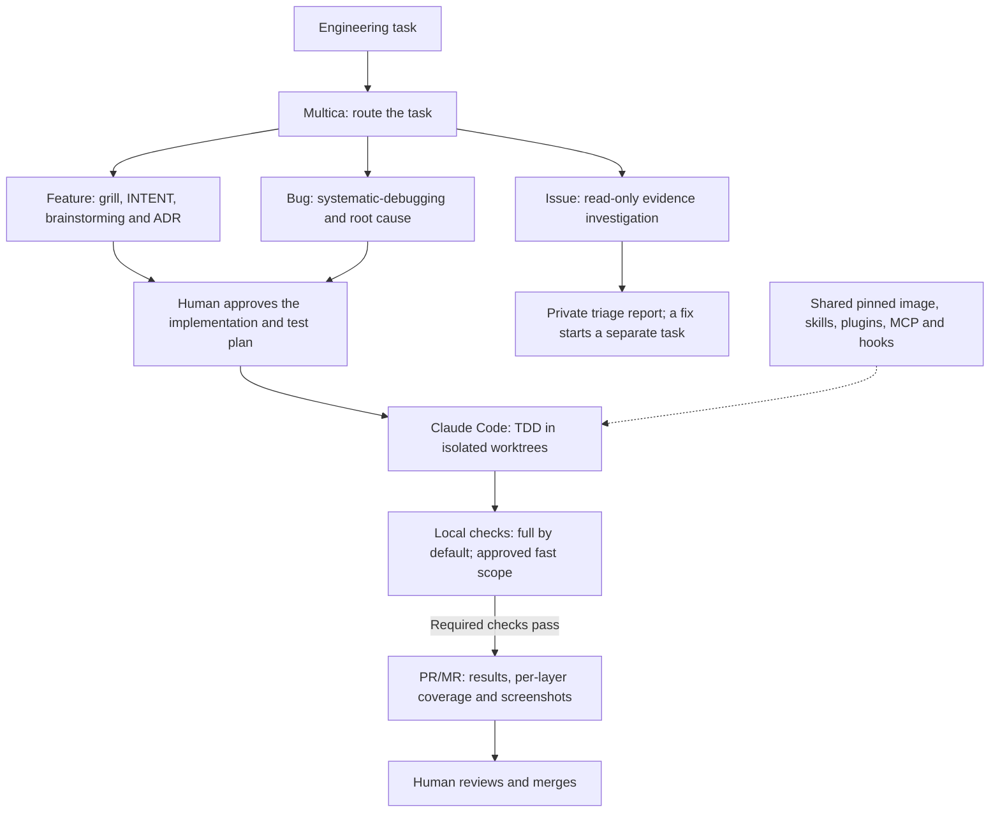
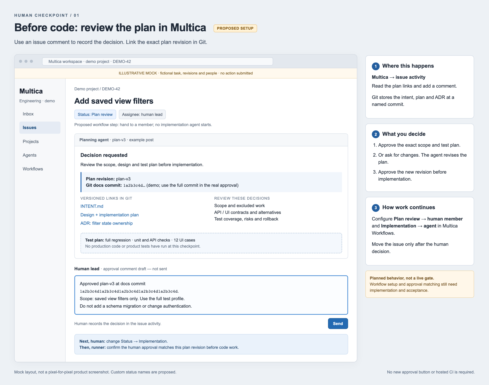

# Tometo


A repeatable setup for Claude Code agents that work through Multica.
**Tometo** is the framework name. Its mascot is a manga-style tomato on a white background.

**Status:** strategy and setup preparation, 22 November 2026. No Multica service or runner has been deployed by this repository.
The image builder and setup CLI are implemented. Real image/runtime certification, private extensions and product verification adapters remain acceptance work.

## What this project is about

Tometo defines how AI agents help TipTip engineers develop features, investigate bugs and triage issues.
Multica assigns the work. Claude Code runs it inside pinned containers on dedicated worker VMs.

Every runner receives the same approved skills, plugins, MCP definitions, toolchain catalog and hooks.
Each repository keeps its own locked dependencies, tests and project guidance.
Parallel agents use separate worktrees and test services, so they do not edit one shared workspace.

The strategy is documented and tracked. Phase 0 proves Ronda's edit-and-check loop before fleet rollout or parallel scaling.
Start with [repository readiness](docs/repository-readiness.md) and the [implementation issues](docs/implementation.md#tracking-issues). Ronda is the first pilot.

## Workflow sequence

This graph shows the planned workflow. It does not claim that runners are deployed.



| Workflow | First steps | Result |
| --- | --- | --- |
| Feature development | Use grill-with-docs. Create a task-specific INTENT.md. Use Superpowers brainstorming. Record the design and architecture decision record (ADR). | A human approves the implementation and test plan before agents write code. |
| Bug triage | Use Superpowers systematic-debugging. Reproduce the bug and confirm its cause. | A human approves the fix plan. The agent adds a failed regression test before the fix. |
| Issue triage | Use the TipTip issue-triage skill. Start with Loki, then use its conditional Sentry, browser and deployed-source checks. | A private evidence report. A code fix starts a separate approved task. |

For any code task, the agent follows this sequence:

1. Obtain human approval for the implementation and test plan.
2. Write a test that fails for the missing behavior. Implement the change, then refactor while tests pass.
3. Run the local checks on the candidate commit. Use full regression unless the approved change scope permits fast mode.
4. Report unit line/branch coverage and integration/UI scenario coverage separately. Name every omitted or unavailable check.
5. Publish a PR/MR with actual results, the tested commit, coverage, mode and screenshots for visual changes.
6. Ask a human to review the result and perform the merge. Agent instructions reserve merging for humans.

A failed required check blocks PR publication. The agent fixes the cause and repeats the relevant checks.
New commits need fresh evidence. A material plan change returns to human plan review.
Fast mode normally excludes functional UI regression; the PR must state that limit.

### Visual overview

The stack-diagram view follows the same nodes and edges as the Mermaid source above.
Blue arrows show task progress. The dashed arrow supplies the shared runner release.

<picture>
  <source media="(prefers-color-scheme: dark)" srcset="docs/diagrams/workflow-dark.png">
  
</picture>

Sources: [Mermaid](docs/diagrams/workflow.mmd), [diagram layout](docs/diagrams/workflow.source.html), [offline HTML](docs/diagrams/workflow.html).
Read the [strategy](docs/strategy.md) for the full workflow rules and human review checklist.

## Where humans review the work

Use Multica for plan review and the Git host for code review and merge.
The screens below are illustrative mocks, shown in chat before publication here.
All task IDs, comments, commits, test results and coverage values in them are fictional.

| Checkpoint | Tool and feature | Human action | Record |
| --- | --- | --- | --- |
| Before code | Multica issue activity and a workflow step assigned to a human | Review the plan. Post approval for its exact revision. Move the issue to Implementation. | Human comment, plan revision, full Git docs commit and scope |
| Before merge | GitHub PR Conversation, Files changed and Review changes | Read local evidence. Review the code and tests. Submit a review, then merge. | Current PR head, results, coverage, screenshots and human review |

### Before code: Multica plan review



1. The planning agent posts the intent, design, ADR and implementation/test plan links on the Multica issue.
2. The links point to a fixed Git docs commit. Planning can create documents before production code work starts.
3. The issue enters **Plan review**, a proposed workflow step assigned to a human member.
4. The human checks scope, alternatives, contracts, acceptance cases, coverage, risks and rollback.
5. The human posts approval with the plan revision, full docs commit and any scope limits.
6. The human changes the issue status to **Implementation**, which hands work to the coding agent.
7. Before code work, the runner checks the approval author and confirms the approved revision and scope still match.

Example approval format:

```text
Approved <plan revision> at docs commit <full Git commit>.
Scope: <approved changes and exclusions>.
Test mode and acceptance: <approved profile and cases>.
```

Configure the handoffs under **Multica Settings → Workflows**.
**Plan review → Hand to a member** avoids starting an implementation agent at that step.
**Implementation → Hand to an agent** starts the implementation step when the human moves the issue.
These status names are our proposed configuration, not built-in approval buttons.
A status change alone does not replace the approval comment. Approval matching is planned runner behavior that still needs acceptance.

If the plan needs changes, the human requests them before implementation.
The planner publishes a new revision and requests approval again.
Only a decision from an authorized human counts; an agent's approval text does not authorize implementation.

### Before merge: Git-host PR or MR review


1. The runner passes the required local checks, then publishes the PR/MR with the shared description template.
2. In GitHub **Conversation**, the human reads the plan link, tested commit, mode, logs, coverage and screenshots.
3. The human checks that the evidence matches the current PR head and names all omitted test layers.
4. In **Files changed**, the human reviews behavior, test assertions, contracts, data changes and rollback.
5. The human chooses **Review changes → Approve → Submit review**, or requests changes.
6. After acceptance, a human uses **Merge pull request**. The agent records the outcome and PR link on the Multica issue.

New commits need fresh relevant evidence. Material changes need a new human review.
Fast-mode results must state that functional UI regression did not run when that layer is excluded.
Other Git hosts use their equivalent PR/MR discussion, review and merge features through the publication adapter.

The agent's merge restriction remains an instruction-based boundary.
No hosted workflow, ruleset or branch protection is required. GitHub may still show merge controls before approval.
The mock review and merge controls do not prove that any real approval or merge occurred.

Editable sources: [before code](docs/checkpoints/before-code.html), [before merge](docs/checkpoints/before-merge.html).
The mock screens are static HTML rendered in Chromium; no product session or production data was captured.

Feature references: [Multica comments](https://multica.ai/docs/comments), [Multica workflows](https://multica.ai/docs/workflows),
[GitHub PR reviews](https://docs.github.com/en/pull-requests/how-tos/review-pull-requests/reviewing-proposed-changes-in-a-pull-request).
The approval wording and workflow mapping above are this project's proposed conventions.

## Start here

- [Intent and decisions](INTENT.md)
- [Strategy](docs/strategy.md)
- [Tests, coverage and full/fast modes](docs/testing.md)
- [Runner setup](docs/runner-setup.md)
- [Repository readiness / Phase 0](docs/repository-readiness.md)
- [Implementation work](docs/implementation.md)
- [Preparation validation](docs/validation.md)
- [PR description template](templates/pull-request-description.md)
- [Runner instructions](runner/multica-claude.local.md)

Run tests locally. A hosted workflow, GitHub Pro, ruleset or branch-protection API is **not required**.
Agents may commit, push task branches and open PRs/MRs. Instructions reserve merge and default-branch writes for humans.
This is an instruction-based trust model, not a claim of Git-server enforcement.

## Set up a runner with Tometo

Tometo installs the shared tools **inside a container image**. It checks Docker and Compose, builds the image, checks tool versions and prepares a runner bundle.
It does not install host runtimes, read tokens, log in or start the runner.
The setup host needs **Node 22.8+, Docker with a running engine, and Docker Compose**.
On macOS, start your existing Colima engine before setup if needed. Tometo does not start a VM for you.

The current installer exposes the `potato` command. Run it from this repository through npx:

```bash
npx --yes --package=https://github.com/rhapsodixx/opinionated-multica/archive/05e2c89add4a2946a5eb4bca970bd1c438a54128.tar.gz potato setup
```

The command pins the tested source commit and downloads a GitHub archive, so the setup host does not need Git.
The package is not published to npm. This command does not use an unrelated npm package named `potato`.
Promote a new source commit only after its local checks and package smoke pass.

From a checkout, use the same installer through Bash:

```bash
bash setup.sh
```

The ASCII mascot and progress indicator animate in an interactive terminal. Use `--no-animation` for plain output.
Preview the steps without Docker calls or file writes:

```bash
bash setup.sh --plan
```

For unattended setup on the selected worker VM:

```bash
bash setup.sh --yes --no-animation \
  --server https://multica.example.test \
  --workspace engineering \
  --output bundles/worker-01 \
  --token-file /secure/path/multica-token
```

The token file is only needed for the later login. Keep it outside Git and create it with owner-only permissions.
The setup command accepts its path, never the token value.

After reviewing the bundle, preview startup separately:

```bash
bash bundles/worker-01/start-runner.sh --plan
```

`--apply` on that generated script performs the later login and startup. The installer never calls it.
A local build records its immutable image ID. Fleet rollout requires one certified published image digest and the approved private extension release.
Docker image builds and native extension acceptance remain separate from the mocked installer tests.

## Verify the preparation helpers

Install Python 3.12+ and uv. Then run:

```bash
uv sync --locked
uv run --locked python scripts/check.py full
```

For a reviewed small/non-code change:

```bash
uv run --locked python scripts/check.py fast
```

Reports are written to `reports/<mode>/`: test logs, coverage JSON/XML and a summary with mode, results and omitted layers.
This repository has no UI. Its report labels functional UI coverage **not applicable**, never passed.
Product repositories with a UI must report their actual functional scenario coverage.

## Preparation tools

- `scripts/prepare-runner.py`: validate an approved immutable image release and generate a local Compose bundle.
- `scripts/doctor-runner.py`: compare installed tool versions with that release, inside the image.
- The generated `start-runner.sh` previews by default. `--apply` logs in through stdin and starts the runner on the chosen VM.

The Tometo installer builds the shared image; the lower-level helpers prepare a bundle from an existing release.
See the [image contract](docs/runner-setup.md#image-contract) and [pinned toolchain](docs/image-toolchain.md).
The release example intentionally contains unresolved pins. Preparation rejects it until an operator provides approved values.

This repository is public. Supply private plugins, MCP credentials and account tokens separately. Do not copy a laptop HOME here.

## Credits

Tometo is heavily influenced by **Lauren Tan (poteto)** and her talk,
[All Code Is Slop (Except Mine)](https://www.youtube.com/watch?v=O_zcc6Xl12g).
Her Poteto pyramid shapes our focus on codebase design, repeatable checks, runtime verification and human judgment.
The framework and its tomato mascot are named **Tometo** as a nod to poteto.
