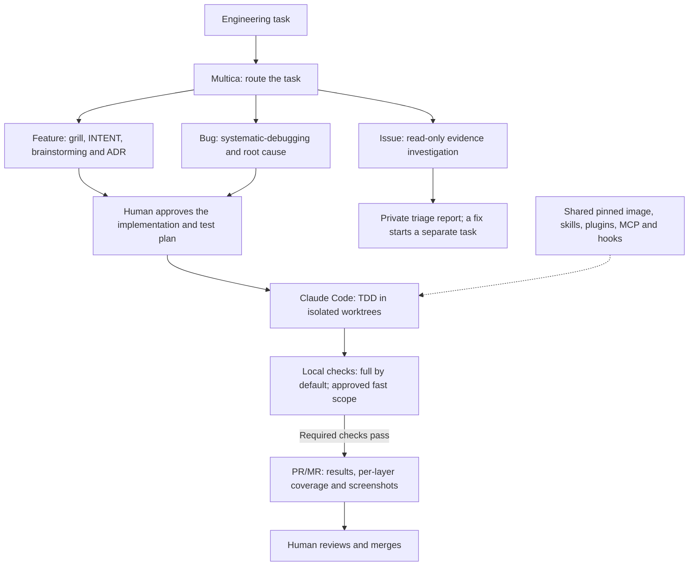
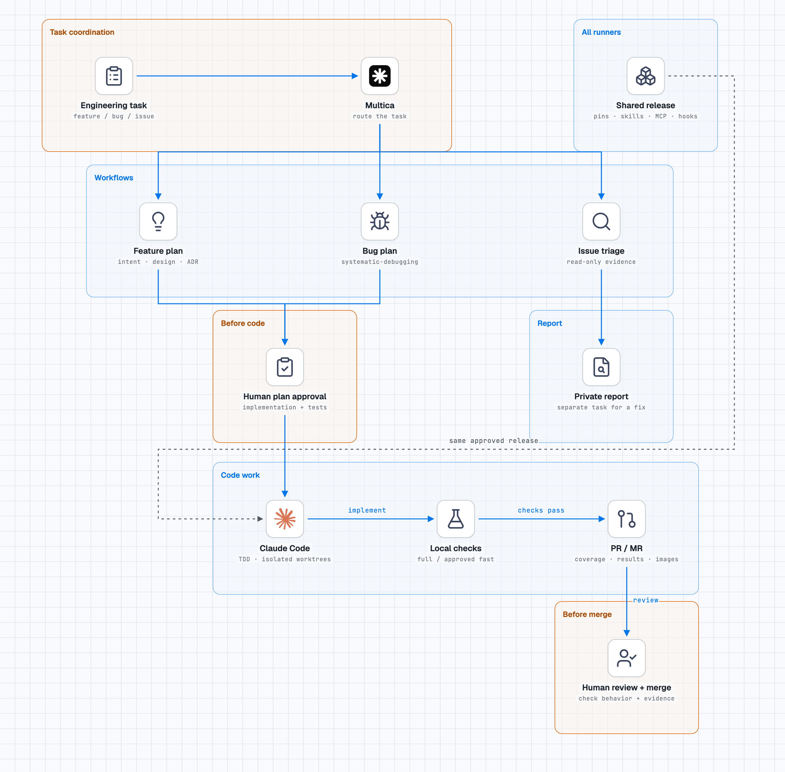
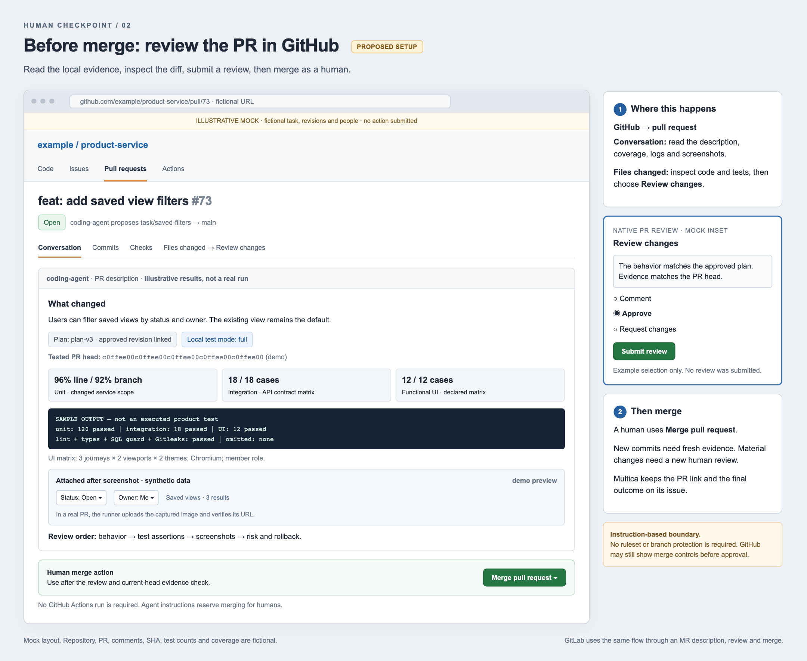

# Potato


A potato-inspired workflow for a **not-so-dark software factory**, heavily influenced by **poteto (Lauren Tan)**.

**Status:** setup and doctor commands implemented, 23 November 2026. No Multica service or runner has been deployed by this repository.
Real image/runtime certification, private extensions and product verification adapters remain acceptance work.

Setup guide: [what to prepare](#what-to-prepare) · [requirements](#setup-requirements) · [setup steps](#how-to-set-up).

## Philosophy

A plain potato is simple to cook: **nutrient-dense, naturally low in fat and sodium, and free of cholesterol**.
It gives you the essentials without a complicated recipe.

We aim for a workflow that is simple enough to understand, run and improve, while keeping intent, verification and human decisions visible.
Start with a working edit-and-check loop. Add more agents only when that loop holds up.

## What this project is about

Potato defines how AI agents help TipTip engineers develop features, investigate bugs and triage issues.
Multica assigns the work. Claude Code runs it inside pinned containers on dedicated worker VMs.

Every runner receives the same approved skills, plugins, MCP definitions, toolchain catalog and hooks.
Each repository keeps its own locked dependencies, tests and project guidance.
Parallel agents use separate worktrees and test services, so they do not edit one shared workspace.

The strategy is documented and tracked. Phase 0 proves Ronda's edit-and-check loop before fleet rollout or parallel scaling.
Start with [repository readiness](docs/repository-readiness.md) and the [implementation issues](docs/implementation.md#tracking-issues). Ronda is the first pilot.

For the next steps, read [npm publication and the four-runtime pilot](docs/publishing-and-pilot.md).
It covers Multica on Terracotta and runners on the same host, a MacBook, a Ryzen laptop and a small VPS.
It separates implemented setup from the remaining release and deployment work.

## Workflow sequence

This graph shows the planned workflow. It does not claim that runners are deployed.



| Workflow | First steps | Result |
| --- | --- | --- |
| Feature development | Use grill-with-docs. Create a task-specific INTENT.md. Use Superpowers brainstorming. Record the design and architecture decision record (ADR). | A human approves the implementation and test plan before agents write code. |
| Bug triage | Use Superpowers systematic-debugging. Reproduce the bug and confirm its cause. | A human approves the fix plan. The agent adds a failed regression test before the fix. |
| Issue triage | Use the TipTip issue-triage skill. Start with Loki, then use its conditional Sentry, browser and deployed-source checks. | A private evidence report. A code fix starts a separate approved task. |

For any code task, the agent follows this sequence:

1. Obtain human approval for the implementation and test plan.
2. Write a test that fails for the missing behavior. Implement the change, then refactor while tests pass.
3. Run the local checks on the candidate commit. Use full regression unless the approved change scope permits fast mode.
4. Report unit line/branch coverage and integration/UI scenario coverage separately. Name every omitted or unavailable check.
5. Publish a PR/MR with actual results, the tested commit, coverage, mode and screenshots for visual changes.
6. Ask a human to review the result and perform the merge. Agent instructions reserve merging for humans.

A failed required check blocks PR publication. The agent fixes the cause and repeats the relevant checks.
New commits need fresh evidence. A material plan change returns to human plan review.
Fast mode normally excludes functional UI regression; the PR must state that limit.

### Final browser checks with Playwright

Use Playwright for changes that affect a UI journey and can run in an isolated test environment.
Run it after static checks, unit tests and integration/API tests, before publishing the PR/MR.
Use the repository's locked Node or Python tests and matching browser revisions; reuse Ronda's existing Python harness first.

Every runner should receive the same approved browser-verification skill and pinned Playwright MCP definition.
MCP helps agents explore, reproduce issues and capture screenshots. Repeatable tests run through the repository's test command.
Report journey coverage, the browser matrix, actual results, screenshots and supported failure traces.
Required missing tests block publication. Approved fast-mode omissions remain explicit; repositories without a UI report N/A.

Read the [Playwright test policy](docs/testing.md#playwright-as-the-final-browser-check).
Native skill/MCP delivery and real product browser tests still need certification.

### Visual overview

The stack-diagram view follows the same nodes and edges as the Mermaid source above.
Blue arrows show task progress. The dashed arrow supplies the shared runner release.

<picture>
  <source media="(prefers-color-scheme: dark)" srcset="docs/diagrams/workflow-dark.png">
  
</picture>

Sources: [Mermaid](docs/diagrams/workflow.mmd), [diagram layout](docs/diagrams/workflow.source.html), [offline HTML](docs/diagrams/workflow.html).
Read the [strategy](docs/strategy.md) for the full workflow rules and human review checklist.

## Where humans review the work

Use Multica for plan review and the Git host for code review and merge.
The screens below are illustrative mocks, shown in chat before publication here.
All task IDs, comments, commits, test results and coverage values in them are fictional.

| Checkpoint | Tool and feature | Human action | Record |
| --- | --- | --- | --- |
| Before code | Multica issue activity and a workflow step assigned to a human | Review the plan. Post approval for its exact revision. Move the issue to Implementation. | Human comment, plan revision, full Git docs commit and scope |
| Before merge | GitHub PR Conversation, Files changed and Review changes | Read local evidence. Review the code and tests. Submit a review, then merge. | Current PR head, results, coverage, screenshots and human review |

### Before code: Multica plan review


1. The planning agent posts the intent, design, ADR and implementation/test plan links on the Multica issue.
2. The links point to a fixed Git docs commit. Planning can create documents before production code work starts.
3. The issue enters **Plan review**, a proposed workflow step assigned to a human member.
4. The human checks scope, alternatives, contracts, acceptance cases, coverage, risks and rollback.
5. The human posts approval with the plan revision, full docs commit and any scope limits.
6. The human changes the issue status to **Implementation**, which hands work to the coding agent.
7. Before code work, the runner checks the approval author and confirms the approved revision and scope still match.

Example approval format:

```text
Approved <plan revision> at docs commit <full Git commit>.
Scope: <approved changes and exclusions>.
Test mode and acceptance: <approved profile and cases>.
```

Configure the handoffs under **Multica Settings → Workflows**.
**Plan review → Hand to a member** avoids starting an implementation agent at that step.
**Implementation → Hand to an agent** starts the implementation step when the human moves the issue.
These status names are our proposed configuration, not built-in approval buttons.
A status change alone does not replace the approval comment. Approval matching is planned runner behavior that still needs acceptance.

If the plan needs changes, the human requests them before implementation.
The planner publishes a new revision and requests approval again.
Only a decision from an authorized human counts; an agent's approval text does not authorize implementation.

### Before merge: Git-host PR or MR review



1. The runner passes the required local checks, then publishes the PR/MR with the shared description template.
2. In GitHub **Conversation**, the human reads the plan link, tested commit, mode, logs, coverage and screenshots.
3. The human checks that the evidence matches the current PR head and names all omitted test layers.
4. In **Files changed**, the human reviews behavior, test assertions, contracts, data changes and rollback.
5. The human chooses **Review changes → Approve → Submit review**, or requests changes.
6. After acceptance, a human uses **Merge pull request**. The agent records the outcome and PR link on the Multica issue.

New commits need fresh relevant evidence. Material changes need a new human review.
Fast-mode results must state that functional UI regression did not run when that layer is excluded.
Other Git hosts use their equivalent PR/MR discussion, review and merge features through the publication adapter.

The agent's merge restriction remains an instruction-based boundary.
No hosted workflow, ruleset or branch protection is required. GitHub may still show merge controls before approval.
The mock review and merge controls do not prove that any real approval or merge occurred.

Editable sources: [before code](docs/checkpoints/before-code.html), [before merge](docs/checkpoints/before-merge.html).
The mock screens are static HTML rendered in Chromium; no product session or production data was captured.

Feature references: [Multica comments](https://multica.ai/docs/comments), [Multica workflows](https://multica.ai/docs/workflows),
[GitHub PR reviews](https://docs.github.com/en/pull-requests/how-tos/review-pull-requests/reviewing-proposed-changes-in-a-pull-request).
The approval wording and workflow mapping above are this project's proposed conventions.

## Start here

- [Intent and decisions](INTENT.md)
- [Strategy](docs/strategy.md)
- [Tests, coverage and full/fast modes](docs/testing.md)
- [Runner setup](docs/runner-setup.md)
- [Repository readiness / Phase 0](docs/repository-readiness.md)
- [Implementation work](docs/implementation.md)
- [Preparation validation](docs/validation.md)
- [PR description template](templates/pull-request-description.md)
- [Runner instructions](runner/multica-claude.local.md)

Run tests locally. A hosted workflow, GitHub Pro, ruleset or branch-protection API is **not required**.
Agents may commit, push task branches and open PRs/MRs. Instructions reserve merge and default-branch writes for humans.
This is an instruction-based trust model, not a claim of Git-server enforcement.

## What to prepare

Prepare the Multica service first, then one runner. Prove Ronda's baseline before connecting the remaining machines.
Potato builds the common tools inside a container and prepares a bundle. It does not deploy the Multica service.

| Prepare | What you need |
| --- | --- |
| Multica service | Reviewed release, web URL, HTTPS API origin, dedicated PostgreSQL volumes, authentication/email settings and a tested backup |
| Workspace | Workspace slug, pilot project, Ronda Git remote, human reviewers and the three workflow definitions |
| Worker machine | Native architecture, Docker/Compose, approved CPU/RAM limits and enough measured space for builds, dependencies, browsers and evidence |
| Runner identity | Unique worker name, separate persistent home, Multica login token and approved Claude/Git authentication |
| Shared capabilities | One approved policy/toolchain release, private skill/plugin bundle, MCP definitions and hooks; credentials delivered separately |
| Repository | Clean checkout, engine-agnostic guidance, locked dependencies and a reviewed `.potato/repository.json` |
| Test environment | Synthetic fixtures, disposable services, actual full/fast commands, coverage outputs and applicable Playwright journeys |
| Evidence and review | PR/MR access, an approved evidence location, plan approval and human merge review |

The private extension bundle, native acceptance and product verification adapters are still pilot work.
Preparing a bundle does not make those capabilities available automatically.

## Setup requirements

| Location | Requirements |
| --- | --- |
| Every setup host | Node **22.8+**, npm for npx, Bash, Docker CLI, a running Linux Docker engine and modern Docker Compose |
| Supported architectures | Native `amd64`/`x64` or `arm64`; certify each image architecture before rollout |
| This MacBook | Colima with its Docker runtime and working `docker compose`; keep the output directory on a Docker-shared path |
| Linux workers | Docker Engine and Compose, with permission to access the selected engine |
| Windows laptop, if applicable | WSL2 with Linux containers; run the setup commands inside WSL |
| Checkout-based setup | Git; the archive-based npx alternative below does not need Git |
| Multica server | Docker/Compose, Git, Make, curl and OpenSSL; reviewed reverse-proxy, database and authentication configuration |
| Maintainer checks only | Python **3.12+** and uv to run this repository's tests; these are not host requirements for the Node installer |

The image supplies pinned Claude Code, Multica, Node/Bun, Go, Python and the common verification tools.
Project dependencies and Playwright browser revisions remain locked per repository.

Setup defaults to **2 CPUs and 4 GB RAM per runner**. These are configuration defaults, not measured build requirements.
The Docker VM must accommodate those limits while leaving resources for the host and test services.
Image builds need their own headroom. Doctor reports workspace disk availability; it does not measure all Docker VM storage or future build peaks.
See the [four-runtime pilot budgets](docs/publishing-and-pilot.md#pilot-topology) before sizing each machine.

## How to set up

Replace the example domain, workspace, paths and worker name with approved values before running setup.
The commands below prepare one worker. Use a distinct bundle directory and credentials for every additional worker.

### 1. Prepare Multica on Terracotta

Follow the [Multica self-host quickstart](https://multica.ai/docs/self-host-quickstart) using a reviewed release.
The service runs the web app, API and PostgreSQL. Use the existing Caddy HTTPS arrangement and dedicated persistent database volumes.
Confirm database and migration readiness through the API's `/readyz` endpoint before connecting workers.
Create the workspace, configure member access/email and test backup restoration.
Record the **API origin** separately from the web URL; `--server` expects an origin without a path such as `/api`.

Measure Terracotta's current load and disk space before deployment or enabling a same-host runner.
Use the [rollout plan](docs/publishing-and-pilot.md#rollout-sequence-and-acceptance) for the full coordinator acceptance checklist.

### 2. Get the tested setup source

```bash
git clone https://github.com/rhapsodixx/opinionated-multica.git potato
cd potato
git checkout --detach 6d85995719a49981629c049e3bd369d8cd390199
```

This pins the tested source containing doctor. It is a pilot source revision, not a certified deployed runner release.
Use an existing reviewed checkout instead if you already have one.

The package is not published to npm. As an alternative to cloning, run the pinned GitHub archive:

```bash
npx --yes --package=https://github.com/rhapsodixx/opinionated-multica/archive/6d85995719a49981629c049e3bd369d8cd390199.tar.gz potato setup
```

Use one setup method. Do not substitute an unrelated public npm package named `potato`.
The remaining examples use the checkout method.

### 3. Prepare the worker's Docker engine

On macOS, install the Docker CLI and Colima using the [Colima installation guide](https://github.com/abiosoft/colima#installation).
Install modern Compose and confirm its Docker CLI plugin works with Colima.
For a stopped or new Colima VM, an example starting budget is:

```bash
colima start --cpu 4 --memory 6
```

These example limits suit the proposed Mac pilot; adjust them after measurement.
Inspect an existing VM before changing its resources. Do not interrupt other work to resize it.
On Linux or WSL, prepare the approved Docker engine instead.

Check the selected engine and host runtime:

```bash
node --version
docker context show
docker info
docker compose version
node bin/potato.mjs doctor --cpus 2 --memory 4g
```

Fix required failures before building. Potato does not install host tools or start Colima for you.
The worker scripts support a modern standalone `docker-compose` fallback; the Multica server requires the supported Compose plugin form.

### 4. Prepare the repository profile

Use a separate Ronda checkout, such as `../ronda` relative to the Potato checkout.
Create and review `.potato/repository.json` in that repository using [the profile example](config/repository.example.json).
Keep an existing approved profile. Replace example commands and coverage paths with the repository's actual values.
Declare every project manifest/lockfile, full/fast commands, check commands, coverage paths and UI applicability.
For Ronda, reuse its confirmed Python Playwright harness and matching locked browser version.

```bash
node bin/potato.mjs doctor --repo ../ronda --json
```

Read `configurationReady` and each result. A required browser probe can remain `NOT CHECKED` until dependencies are prepared in the intended runtime.
That report exits nonzero and must not be called fully ready.
The [doctor guide](docs/doctor.md) explains the profile schema and live checks.

### 5. Build the image and prepare a bundle

Preview the installer first:

```bash
bash setup.sh --plan
```

Then prepare the selected worker:

```bash
bash setup.sh --yes --no-animation \
  --server https://multica-api.example.test \
  --workspace engineering \
  --output bundles/worker-01 \
  --token-file "$HOME/.config/potato/worker-01.token" \
  --repo ../ronda \
  --cpus 2 \
  --memory 4g
```

Use `bash setup.sh` for the interactive wizard. Its ASCII mascot and progress animate; `--no-animation` selects plain output.
Setup checks Docker/Compose and VM limits, builds the pinned image, checks installed tool versions, prepares files and validates Compose.
It refuses a nonempty output directory. The token file need not exist yet because setup records its path without reading it.
It does not log in, start the daemon or run repository tests.

The `--repo` option only inspects the host checkout. It does not clone or mount that checkout into the coding container.
A local build records its immutable image ID. The current installer builds on each host; shared prebuilt-image consumption remains planned work.
Fleet rollout needs a certified multi-platform registry release and approved private extensions.

### 6. Review the bundle and prepare runtime access

```bash
node bin/potato.mjs doctor --bundle ./bundles/worker-01 --probe --json
bash bundles/worker-01/start-runner.sh --plan
```

The explicit probe runs the existing version doctor in the already-present image. It never pulls another image.
Inspect the generated Compose configuration, policy, limits and mounted files.
Native skills, plugins, hooks, MCP behavior and authentication still report `NOT CHECKED`; the bundle report therefore remains incomplete.

Before accepting agent work, provide the approved private extensions and scoped Claude/Git authentication through the runner-owned home and supported configuration.
Prepare a fresh project checkout, locked dependencies, browser binaries and disposable test services inside the intended runner environment.
Use `/home/runner/workspaces/ronda` only if that is the actual prepared checkout path.
Keep each runner's identity separate. Do not copy a personal Claude home, production data or the host Docker socket.
These private delivery and runtime acceptance steps are not automated by the installer yet.

### 7. Log in and start explicitly

Obtain a token for this runner's approved Multica identity. Store it at the configured path outside Git with owner-only permissions.
Use the secret-delivery process; do not put the token value into a command or this README.
After reviewing the startup plan, apply it on the chosen worker:

```bash
chmod 600 "$HOME/.config/potato/worker-01.token"
bash bundles/worker-01/start-runner.sh --apply
docker compose -f bundles/worker-01/compose.json ps
```

`--apply` reads the token through stdin, performs Multica login and starts the daemon under Compose.
It does not complete Claude login or private extension delivery.
Confirm the runtime appears in the correct workspace. Keep one daemon task and one agent task per worker during the initial pilot.

### 8. Verify the actual runtime before the first task

After preparing the checkout inside the running container, inspect and probe it there:

```bash
docker compose -f bundles/worker-01/compose.json exec runner \
  potato doctor --repo /home/runner/workspaces/ronda --repo-only --probe --json
```

Repository-only scope needs no Docker socket. The browser probe proves launch and a synthetic assertion, not a product journey.
Run the repository's approved full baseline separately and record failures, coverage and synthetic UI results.
Complete native skill/plugin/MCP, authentication and Multica connectivity acceptance before assigning code work.
Humans still approve each implementation plan and review the resulting PR/MR before merge.
Expand to the other machines only after this loop works; follow the [pilot rollout sequence](docs/publishing-and-pilot.md#rollout-sequence-and-acceptance).

## Verify the preparation helpers

Install Python 3.12+ and uv. Then run:

```bash
uv sync --locked
uv run --locked python scripts/check.py full
```

For a reviewed small/non-code change:

```bash
uv run --locked python scripts/check.py fast
```

Reports are written to `reports/<mode>/`: test logs, coverage JSON/XML and a summary with mode, results and omitted layers.
This repository has no UI. Its report labels functional UI coverage **not applicable**, never passed.
Product repositories with a UI must report their actual functional scenario coverage.

## Preparation tools

- `scripts/prepare-runner.py`: validate an approved immutable image release and generate a local Compose bundle.
- `scripts/doctor-runner.py`: compare installed tool versions with that release, inside the image.
- The generated `start-runner.sh` previews by default. `--apply` logs in through stdin and starts the runner on the chosen VM.

The Potato installer builds the shared image; the lower-level helpers prepare a bundle from an existing release.
See the [image contract](docs/runner-setup.md#image-contract) and [pinned toolchain](docs/image-toolchain.md).
The release example intentionally contains unresolved pins. Preparation rejects it until an operator provides approved values.

This repository is public. Supply private plugins, MCP credentials and account tokens separately. Do not copy a laptop HOME here.

## Credits

- Lauren Tan (poteto) — [All Code Is Slop (Except Mine)](https://www.youtube.com/watch?v=O_zcc6Xl12g)
- Lauren Tan (poteto) and Matt Pocock — [LIVE: Poteto (creator of pstack) on shipping 1,000's of PR's a month at SpaceX](https://www.youtube.com/watch?v=MN9dGgmLyso)
- Kun Chen — [L8 Principal's Agentic Engineering Workflow](https://www.youtube.com/watch?v=iQyg-KypKAA&t=502s)
- Your Average Tech Bro — [My New AI Coding Setup That Helps Me Ship 30+ PRs A Day](https://www.youtube.com/watch?v=54D1hFfaju8&t=1s)
