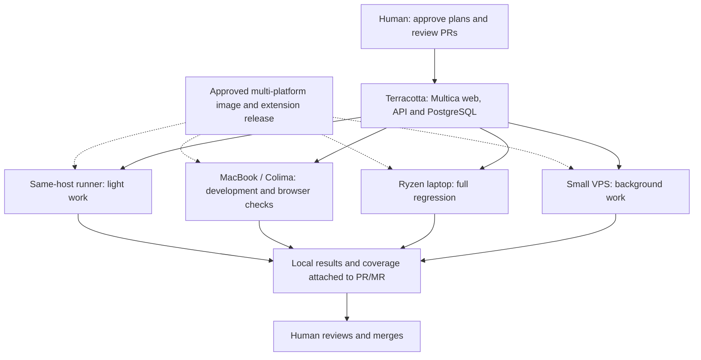

# Publish Potato and run the four-runtime pilot

Status: proposed rollout, 23 November 2026. This document authorizes no publication or deployment.
The existing installer builds an image and prepares a bundle. Authentication and startup remain explicit.
Keep execution tasks, ownership, dependencies and rollout decisions in the private Linear project **opinionated-multica**.
This public guide describes the reusable release and pilot process; use the private project plan to coordinate actual work.

## Publish an npm package for npx

Publish Potato to npm. Then `npx` can download the package and run its declared command.
There is no separate npx registry. A local release does not require a hosted workflow.

Use `@<npm-owner>/potato` with a `potato` executable. Confirm the npm owner before choosing the scope.
GitHub ownership does not establish npm ownership. The examples below use a placeholder scope.

Before publication:

1. Confirm the npm account or organization, package availability and the intended license.
2. Keep the Potato package name, executable, installer labels and public examples consistent.
3. Remove `private: true`. Set the prerelease version to `0.1.0-beta.1`.
4. Retain the explicit package file allowlist. Exclude credentials, private skills, machine settings and generated bundles.
5. Run the full local test profile. Report its coverage and omitted product UI tests.
6. Pack the package. Inspect its file list and secret scan results.
7. Test the actual tarball's help and `--plan` commands from an empty directory.
8. Certify a real image build and bundle preparation before claiming setup works.

The current package remains private and uses `@rhapsodixx/potato` and the `potato` command.
Publication, version and license changes remain planned work.

After those checks, the maintainer can publish locally:

```sh
npm login
npm whoami
npm publish --dry-run --access public --tag next
npm publish --access public --tag next
```

Use account two-factor authentication for this manual release. Keep npm publisher credentials off the runners.
Publishing makes the package public; obtain release approval before that command.

After publication, verify the exact published version from a clean directory:

```sh
npx --yes @<npm-owner>/potato@0.1.0-beta.1 --plan
npx --yes @<npm-owner>/potato@0.1.0-beta.1 setup
```

Replace `<npm-owner>` before use. These are future commands, not commands for a package already published.
Setup prepares the bundle. Review and run its startup script separately.

Keep the pilot on the exact beta version. Promote an accepted release to `latest` only after the pilot passes.
Publish a new version for each package change. Preserve the previous package version and image release for rollback.

## Separate the installer, image and private extensions

| Artifact | Delivery | Contents |
| --- | --- | --- |
| Setup CLI | npm package | Public setup code, validation and bundle templates |
| Shared runner | OCI image registry, immutable digest | Pinned tools and public runner policy |
| Approved extensions | Private, versioned delivery | Skills, plugins and MCP definitions; credentials remain separate |
| Repository | Normal Git remote | Engine-agnostic guidance, locked dependencies and local test profile |

Build and certify native `linux/arm64` and `linux/amd64` images.
Publish one multi-platform release and record its manifest digest and platform digests.
The platforms share tool versions and policy; their image bytes and platform digests differ.
Do not use AMD64 emulation as ARM64 certification.

The installer currently rebuilds on each host and records a local image ID.
The Python preparation helper already accepts a registry digest.
Extend the installer to consume an approved prebuilt release before distributing it to all four machines.
Retain explicit startup and resource limits. Do not add an automatic login or daemon start.

## Pilot topology

The coordinator runs Multica's web service, API and dedicated PostgreSQL database.
Four separately identified runtimes connect to it: the coordinator host, MacBook, Ryzen laptop and small VPS.
Multica supports computers on the same machine as its service or on separate machines.



These are initial resource proposals, not measured minimum requirements:

| Runtime | Initial budget | First responsibility |
| --- | --- | --- |
| Coordinator-host runner | 0.5 CPU, 1 GB; one task | Triage, documentation and small checks; enable only after measuring coordinator headroom |
| MacBook runner | Colima VM: 4 CPUs, 6 GB; runner: 3 CPUs, 4 GB; one task | Development, browser checks and ARM64 acceptance where supported |
| Ryzen laptop runner | Up to 4 available logical CPUs, 8 GB; one task | Image builds and full regression; adjust for test services and host load |
| 2-vCPU, 8-GB VPS runner | 1.5 CPUs, 4 GB; one task | Unit, lint, type checks and smaller integration work |

All four retain the same capabilities. Scheduling changes by available resources.
Full regression remains the default for code changes. A small machine does not justify an unapproved fast profile.
Route heavy work to a capable machine or leave it queued.
Tests used for a PR must run on its candidate commit in the approved environment.

Each machine needs Node 22.8+, a running Docker engine and modern Docker Compose.
Use Colima on the Mac. Verify the `docker compose` plugin works through Colima; repair stale plugin links first.
Confirm the Ryzen laptop and VPS operating systems before writing host installation commands.
Linux or WSL2 with Linux containers can use the AMD64 release; macOS uses its native architecture release.

Use one persistent runner identity and home volume per runtime.
Deliver the same approved extension release and `multica-claude.local.md` to each runtime.
Do not copy a personal Claude home or inherit private laptop instructions.
Use separate credentials and confirm Claude authentication and concurrent-use limits before assigning work.
Set `MULTICA_DAEMON_MAX_CONCURRENT_TASKS=1`; also set each pilot agent's concurrency to one.
Four registered runtimes do not mean four simultaneous implementation jobs.

## Rollout sequence and acceptance

### 1. Prepare Terracotta and the coordinator

- Measure current CPU, available RAM, swap pressure, filesystem space and Docker storage.
- Resolve disk and memory pressure before deployment. Do not delete application data or prune shared resources blindly.
- Pin the Multica source or image release. Review its Compose file and required settings before deployment.
- Use a dedicated Compose project, database, secrets and persistent volumes.
- Route web and API traffic through the existing Caddy HTTPS configuration. Keep database ports private.
- Configure the public URLs, production authentication, approved members and email delivery.
- Back up the database and secrets. Prove restoration before accepting real task history.
- Create the pilot workspace and three workflow definitions. Keep plan approval and merge review assigned to humans.

Acceptance: authenticated access works, an unauthorized user cannot join, backups restore, and existing applications retain their baseline behavior.
The coordinator-host runner stays stopped until service load and storage headroom permit it.

### 2. Prove Ronda's edit-and-check loop

Use the [Phase 0 readiness plan](repository-readiness.md).
Record a fixed baseline SHA, actual test commands, known failures, coverage and synthetic fixtures.
Prove a small edit, a failed test and a corrected test using the minimum runner image.
Include Python, the TypeScript UI and the required Go tooling without inventing a standalone Go application.

Acceptance: a fresh checkout reproduces the baseline without production data or undeclared laptop dependencies.
Resolve or explicitly record baseline failures before claiming that a pilot change passed.

### 3. Certify the release and publish the beta

Build and test the image on the Mac and Ryzen host for the applicable architectures.
Prove actual Claude skill, plugin, MCP and delegated-agent behavior under the headless launcher.
Prove that private laptop instructions do not load.
Include the shared browser-verification skill and pinned Playwright MCP definition in native delivery acceptance.
Prove repository-locked Playwright browser launches and synthetic assertions on each applicable architecture.
Implement prebuilt-release consumption, then test the packed installer against that release.
Complete the npm release checklist above after owner and license confirmation.

Acceptance: two clean runners report the same policy, catalog and tool versions; platform digests match the approved release.
The installed beta prepares a usable bundle without reading a token or starting a runner.

### 4. Connect and calibrate the four runtimes

Connect the Mac first, then Ryzen, then the small VPS, then the coordinator-host runner if capacity permits.
Perform explicit authentication and startup on each host.
Run the same small synthetic repository check on all four runtimes.
Verify reconnection after restart, queued work while offline, cancellation and cleanup of task-owned worktrees.
Keep laptops' sleep and network availability visible when assigning work.

Acceptance: all four have distinct identities and matching approved capabilities.
Each produces real command output and coverage. No runner mounts the production Docker socket, database or personal home.

### 5. Run three supervised Ronda tasks

1. Run one small feature through grill-with-docs, task INTENT, brainstorming, ADR and human plan approval.
2. Run one reproducible bug through systematic-debugging, a failed regression test, approved fix and passing tests.
3. Replay one synthetic issue through the private, read-only issue-triage workflow.

Use one implementation task at a time initially.
Attach the tested SHA, mode, commands, unit line/branch coverage, integration/UI scenario coverage and actual visual evidence to each code PR.
List omitted or unavailable suites. Apply the shared PR template and Plain English skill.
For feasible UI journeys, run the declared Playwright profile after earlier tests and attach its actual scenario results and visual evidence.
Confirm that failed required checks block publication, and new commits trigger fresh evidence.
Keep human approval before code and human review before merge.

Acceptance: the three workflows finish with traceable evidence and the required human decisions.
A documentation task passing on a light runner does not certify full Ronda regression there.

### 6. Expand only after the first loop works

Try two independent tasks on separate runtimes, branches, worktrees and test services.
Agree on shared contracts first. Serialize migrations, integration and final regression.
Measure queue time, elapsed time, peak RAM, disk growth, model spend, review rework and escaped defects.
Use the [strategy's rollout measures](strategy.md) before increasing concurrency.

Acceptance: independent tasks do not overwrite files, fixtures or services, and integration has current evidence.
Human plan approval and merge review remain after the pilot.

## Test infrastructure, capacity and rollback

Keep test services disposable and separate from production.
The coding container does not receive the host Docker socket.
If Ronda's full profile needs Compose, arrange isolated test infrastructure on the heavy worker and prove agent-to-test connectivity first.
Do not claim that the existing installer already provides this test-service integration.

Measure unpacked image size, build cache, repository dependencies and browser artifacts before setting disk budgets.
Reserve space for a previous image, database backups and bounded evidence retention.
Stop assignment when a worker lacks capacity; do not silently omit tests.

For a runner rollback, stop its daemon and restore the previous image and extension release.
For a coordinator rollback, stop dispatch and restore the compatible service release and tested database backup as required.
Never remove database or runner identity volumes as an installer retry step.

## Decisions still needed

- npm account or organization and license for public distribution.
- Ryzen laptop and VPS operating systems, available disk and CPU architecture.
- Multica hostname, member access and email delivery.
- Image registry and private extension delivery location.
- Claude authentication method and isolated test-service arrangement.

Keep private host inventory, addresses, credentials and measured capacity reports outside this public repository.
This plan proposes the sequence; actual resource limits follow measurement and explicit deployment approval.

## Sources

- [npm: publish scoped public packages](https://docs.npmjs.com/creating-and-publishing-scoped-public-packages/)
- [npm: two-factor authentication](https://docs.npmjs.com/about-two-factor-authentication/)
- [Multica: self-host quickstart](https://multica.ai/docs/self-host-quickstart)
- [Multica: daemon, runtimes and concurrency](https://multica.ai/docs/daemon-runtimes)
